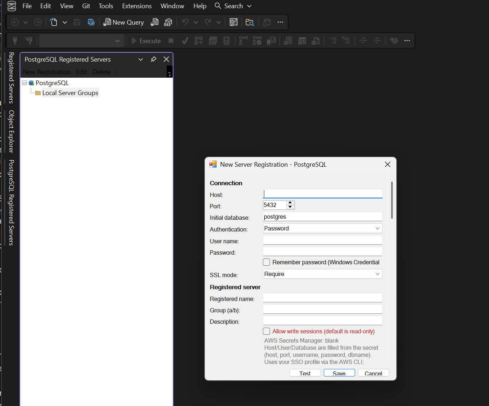
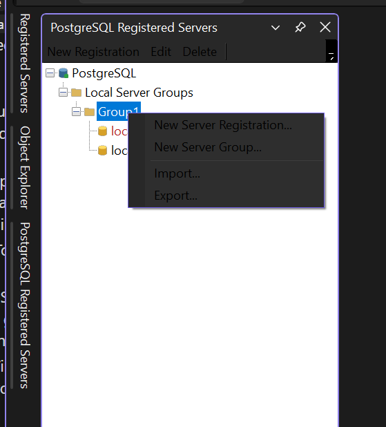
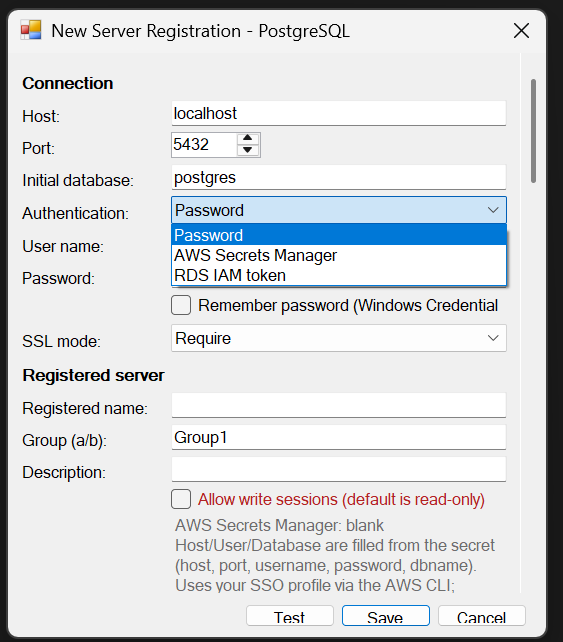

# PostgreSQL Explorer for SSMS 22

> **Preview.** The extension works and is in daily use. The Object Explorer integration relies on SSMS internals that Microsoft doesn't document, so an SSMS update may break it; Registered Servers and query windows keep working if it does. The VSIX isn't code-signed yet, so the installer will say so. Please report issues and attach the diagnostic log (*More > Open diagnostic log*).

An extension for **SQL Server Management Studio 22** that adds PostgreSQL to SSMS. You get Registered Servers, Object Explorer nodes, multi-server queries and an SSMS-style query window for Postgres, without leaving SSMS.



## Features

| SSMS feature | PostgreSQL Explorer |
|---|---|
| **Registered Servers** | **Tools / View > PostgreSQL Registered Servers**: PostgreSQL > Local Server Groups > nested groups > servers. New / Edit / Duplicate / Delete, **Move To** (right-click) or **drag & drop** servers and groups between groups, Rename / Delete Group, Test Connection, Export (JSON, never includes passwords). |
| **Import Registered Servers** | Bring in your existing connections from **pgAdmin 4**, **DataGrip**, **DBeaver** or another PostgreSQL Explorer export. You preview them first and tick what to import, and re-importing updates entries in place. |
| **Object Explorer** | A connected server is added as a root node in SSMS's own Object Explorer: Server > Databases > Schemas / System Schemas > Tables, Views, Materialized Views, Functions, Sequences > Columns (PK / type / nullability) and Indexes (method, size, INVALID). |
| **Context menus** | New Query, Select Top 1000 Rows, Count Rows, Size / Stats, Script as SELECT, Script CREATE (views, functions, indexes), Refresh, Copy name, Disconnect. |
| **Query window** | Tabbed like `SQLQueryN.sql`. Execute the selection or the whole script, Cancel, switch database, multiple result grids, a Messages tab (NOTICEs, row counts, errors with DETAIL / HINT / POSITION), elapsed time, a max-rows cap, and NULLs highlighted. Right-click a result grid for **Copy** (Ctrl+C), **Copy with Headers** (Ctrl+Shift+C), Copy Column Names, **Select All**, **View Value...** (also double-click; pretty-prints JSON) and **Save Results As...** (CSV, tab-delimited or JSON; headers follow SSMS's *Include column headers when saving the results*). |
| **Execution plans** | **Estimated Plan** (Ctrl+L) and **Include Actual Plan** (Ctrl+M), as in SSMS. Graphical plan with operator cost %, actual time, actual vs estimated rows, arrows sized by row count and warning icons, plus Properties, Text and JSON views. *Open in PEV2* is also available. |
| **Format SQL** | **Format SQL** button, right-click menu or **Ctrl+K, Ctrl+Q** (as in SSMS 22.7+; Ctrl+K, Ctrl+D also works). This is a PostgreSQL-aware formatter that **follows your SSMS SQL Formatter settings** (*Tools > Options > SQL Formatter*): keyword / function / identifier casing, aligned or indented clause bodies, comma placement, indentation, multiline lists and new-line rules. Strings, `$tag$` bodies, quoted identifiers and comments are never changed. It formats the selection, or the whole script; Ctrl+Z undoes it. |
| **Script Table as** | Right-click a table > **Script Table as > CREATE To / DROP To / DROP And CREATE To / SELECT To > New Query Editor Window / Clipboard**, controlled by SSMS-style **Scripting Options**. |
| **Activity Monitor** | Live `pg_stat_activity` with blocking, waits and transaction/query age. Right-click a session to **Cancel Query** (`pg_cancel_backend`) or **Kill Session** (`pg_terminate_backend`). |
| **Multi-server query** | Right-click a server group > **New Query (N servers)**. Every batch runs on all servers in the group (including nested groups) in parallel. Results are merged into one grid with a leading **Server Name** column, as with SSMS group queries. The status bar turns pink so you can always tell you're in a group query. |
| **Theme** | Follows the SSMS light / dark / blue theme. |



### Multi-server queries

- **Merge results** (on by default): result set *N* from every server is combined into one grid. If one server returns a different column list, its rows are shown in a separate grid instead of failing the query.
- **Server name** (on by default): adds a frozen `Server Name` column at the front.
- **Database**: by default each server uses its registration's initial database. Type a database name to use the same one on every server.
- Up to 8 servers run at the same time. Each server keeps its own session, so `SET` and temp tables persist between executions. Messages are prefixed with the server name, and the summary line reports *completed on X of N servers*.
- Write mode is only available when **every** server in the group allows writes, and each execution asks for confirmation.

## Execution plans

| Action | SSMS shortcut | What runs |
|---|---|---|
| **Estimated Plan** | Ctrl+L | `EXPLAIN (COSTS, VERBOSE, FORMAT JSON)` for each statement. **Nothing is executed.** |
| **Include Actual Plan** (toggle) + Execute | Ctrl+M, then F5 | `EXPLAIN (ANALYZE, COSTS, VERBOSE, BUFFERS, FORMAT JSON)` for each statement. **The query is executed** but no rows are returned. Statements that can't be explained (`SET`, `CREATE TEMP TABLE`, ...) run normally, so later statements see their effect. |

- **Safety:** under *Include Actual Plan*, data-changing statements (`INSERT` / `UPDATE` / `DELETE` / `MERGE`, data-modifying CTEs) run inside `BEGIN ... ROLLBACK`, or a `SAVEPOINT` if you're already in a transaction, so capturing a plan never commits. Read-only sessions reject them anyway.
- **Graph:** the root operator is on the left and inputs flow in from the right. Each operator shows its **cost %** (exclusive cost relative to the statement) and, for actual plans, **exclusive time (%)** and **actual of estimated rows (%)**. Arrows are sized by row count. Ctrl+wheel zooms.
- **Warnings (⚠):** row estimates off by 10× or more, sorts spilling to disk, hash joins using multiple batches, filters that discard most rows, temp-file writes, Index Only Scans with many heap fetches, and operators that never ran.
- **Batch view:** one entry per statement, labelled *Query N: Query cost (relative to the batch): X %*. *Properties* lists every EXPLAIN field of the selected operator; *Text* is an EXPLAIN-style tree; *JSON* is the raw plan.
- **PEV2:** *Open in PEV2...* copies the plan JSON to the clipboard and opens a local [`pev2.html`](https://github.com/dalibo/pev2/releases/latest) that you download once. It runs entirely in your browser and nothing is uploaded.
- Plans are available in single-server query windows.

## Script Table as

Right-click a table in Object Explorer > **Script Table as > CREATE To / DROP To / DROP And CREATE To / SELECT To**, then pick **New Query Editor Window** or **Clipboard**. All DDL comes from PostgreSQL's own deparsers (`format_type`, `pg_get_expr`, `pg_get_constraintdef`, `pg_get_indexdef`, `pg_get_triggerdef`, `pg_get_partkeydef`, `pg_get_statisticsobjdef`), so it matches the server. Scripting only reads the catalog.

**Scripting follows your SSMS settings.** By default, *Script Table as* reads your own *Tools > Options > SQL Server Object Explorer > Scripting* options live from SSMS (the `sqlServerObjectExplorer.scriptingOptions.*` Unified Settings), so a change in SSMS applies to PostgreSQL too. **Script Table as > Scripting Options...** shows the effective values, lets you turn *Follow my SSMS scripting options* off, and holds the PostgreSQL-only options:

| SSMS option | PostgreSQL output |
|---|---|
| Include descriptive headers | `--` header with object, server, database and date |
| Schema qualify object names | `schema.table` everywhere, including FK targets and types |
| Include IF NOT EXISTS clause | `IF NOT EXISTS` / `IF EXISTS` |
| Script extended properties | `COMMENT ON TABLE / COLUMN / INDEX / CONSTRAINT` |
| Script owner / Script permissions | `ALTER TABLE ... OWNER TO`, `GRANT ...` from the ACL |
| Script primary keys / unique keys / check constraints | inline `CONSTRAINT ...` (check includes `EXCLUDE`) |
| Script foreign keys | `ALTER TABLE ... ADD CONSTRAINT ... FOREIGN KEY` after the CREATE |
| Script indexes / triggers / statistics | non-constraint indexes, `CREATE TRIGGER`, `CREATE STATISTICS` |
| Script defaults / Include identity property / Include collation | column `DEFAULT`, `GENERATED ... AS IDENTITY`, `COLLATE` |
| Script partition schemes | `CREATE TABLE ... PARTITION OF ... FOR VALUES ...` for each partition |
| Script file groups / data compression options | `TABLESPACE` / `WITH (fillfactor, autovacuum_*...)`, `USING <access method>` |
| *(PostgreSQL only)* Script row-level security | `ENABLE ROW LEVEL SECURITY` + `CREATE POLICY` |

Columns include identity (`GENERATED ... AS IDENTITY`), generated columns, defaults, collations and `NOT NULL`. Partitioned tables get `PARTITION BY`, partitions get `PARTITION OF`, and inheritance gets `INHERITS`.

## Activity Monitor

Right-click a server or database (Object Explorer) or a registration (*Connect > Activity Monitor*). It shows a live `pg_stat_activity` grid with user, database, application, client, state, wait event, **Blocked by** (`pg_blocking_pids`), transaction and query age, backend type and `xmin`. The full query text appears below the grid.

- **Auto refresh** (manual / 2 / 5 / 10 / 30 s), **Hide idle**, **This database only**, **System backends**, and a free-text **Filter**.
- Blocked sessions are shown in amber and blockers in red. Transactions older than 5 minutes are flagged. *Show Blocking Sessions* jumps to the blocker.
- **Cancel Query**: `SELECT pg_cancel_backend(pid)` stops the running statement and keeps the session.
- **Kill Session** (Del): `SELECT pg_terminate_backend(pid)` closes the connection and rolls back its transaction.
- Both ask for confirmation and show the pid, user, database, application, client, state, transaction age and query. They're logged to the diagnostic log. Signalling other users' sessions needs `pg_signal_backend` (or `rds_superuser` on RDS). Your own monitor session is greyed out and can't be killed.

## Importing from other tools

**More > Import Registered Servers** (or right-click a group) offers:

| Source | What's read | Notes |
|---|---|---|
| **pgAdmin 4** | A `servers.json` you export from pgAdmin (*Tools > Import/Export Servers > Export*) | Name, group, host, port, maintenance DB, user, SSL mode, comment |
| **DataGrip** | Every project in DataGrip's recent-projects list and `~/DataGripProjects`, plus global data sources: `.idea/dataSources.xml` + `dataSources.local.xml` | DataGrip **AWS Secrets Manager** data sources (`AWS.SecretId`, `AWS.RegionId`, `AWS.CredentialId=profile:<name>`) become Secrets Manager registrations that use the same AWS profile. `getUrlFromSecret` entries take their host from the secret. DataGrip folders become groups. |
| **DBeaver** | `%APPDATA%\DBeaverData\workspace6\*\.dbeaver\data-sources*.json` | Connections, folders, SSL. DBeaver keeps user names in its encrypted credentials file, so you set the user after importing. |
| **PostgreSQL Explorer** | A file made with *Export* | Round-trips everything except passwords |

Imported entries go under a group named after the tool (`DataGrip/...`, `pgAdmin/...`, `DBeaver/...`).

**Passwords are never imported.** The importers only read the connection definitions your own tools saved on your machine, and they never read or decrypt any stored password. Secrets Manager and IAM entries connect with your AWS profile. Password entries prompt on first connect, and you can tick *Remember password* to save it to Windows Credential Manager.

## Read-only by default

Every session runs `SET SESSION CHARACTERISTICS AS TRANSACTION READ ONLY`. Before any write can run, two things have to happen: the registration is marked *Allow write sessions*, **and** the query window is switched to **READ WRITE** (which shows a change-management reminder). This is a guardrail, not a security boundary, since a user can `SET` it back. Real enforcement belongs in database roles.

## Authentication



| Mode | How it works | What's stored |
|---|---|---|
| Password | You're prompted on first connect. *Remember password* saves it to Windows Credential Manager (`SsmsPgExplorer/<id>`). | Credential Manager only, never the JSON file |
| AWS Secrets Manager | Runs `aws secretsmanager get-secret-value` with your AWS CLI / SSO profile. Fields left blank on the registration (host, port, user, dbname) are filled from the secret. | Nothing (kept in memory for 10 minutes) |
| RDS IAM token | Runs `aws rds generate-db-auth-token` with your AWS CLI / SSO profile. | Nothing (kept in memory for 10 minutes) |

If the SSO session has expired, the error message includes the `aws sso login --profile <p>` command to run.

### AWS CLI profile setup (recommended)

The Secrets Manager and RDS IAM modes run **AWS CLI v2** (`aws.exe`) with the profile set on the registration. Nothing AWS-specific is bundled or stored by the extension.

1. **Install AWS CLI v2** and make sure `aws --version` works in a new terminal. SSMS finds `aws.exe` on `PATH` or in `C:\Program Files\Amazon\AWSCLIV2\`. Restart SSMS after installing so it picks up the new `PATH`.
2. **Use IAM Identity Center (SSO) with a shared `sso-session`** instead of long-lived access keys. Then one login covers every profile. In `~/.aws/config`:

   ```ini
   [sso-session my-org]
   sso_start_url = https://<your-portal>.awsapps.com/start
   sso_region = us-east-1
   sso_registration_scopes = sso:account:access

   [profile prod-readonly]
   sso_session = my-org
   sso_account_id = 111111111111
   sso_role_name = DatabaseReadOnly
   region = us-west-2

   [profile dev-readonly]
   sso_session = my-org
   sso_account_id = 222222222222
   sso_role_name = DatabaseReadOnly
   region = us-west-2
   ```

   `aws configure sso` writes these blocks for you interactively.
3. **Sign in** once per session, and check that the profile resolves to the account you expect:

   ```powershell
   aws sso login --sso-session my-org
   aws sts get-caller-identity --profile prod-readonly
   ```

4. **Name profiles `<environment>-<role>`** (for example `prod-readonly` or `dev-admin`) so the registration list shows what each connection can do. If you import from DataGrip, the importer keeps DataGrip's profile names (`AWS.CredentialId=profile:<name>`), so use the same `~/.aws/config` for both tools.
5. **Set `region` on every profile**, or fill *AWS region* on the registration. The registration value wins when both are set.
6. **Least privilege.** The role behind the profile needs:
   - Secrets Manager mode: `secretsmanager:GetSecretValue` on the secret, plus `kms:Decrypt` if the secret uses a customer-managed KMS key.
   - RDS IAM mode: `rds-db:connect` on `arn:aws:rds-db:<region>:<account>:dbuser:<db-resource-id>/<db-user>`. The database user must also be granted `rds_iam`.
7. **Secret format.** Secrets Manager mode expects the standard RDS JSON secret (`username`, `password`, and optionally `host`, `port`, `dbname`). Leave Host, Port, User or Database blank on the registration to take them from the secret.
8. **A custom config location** works through `AWS_CONFIG_FILE` / `AWS_SHARED_CREDENTIALS_FILE`. Set them as user environment variables, then restart SSMS.

Tokens are cached by the AWS CLI (`~/.aws/sso/cache`). The extension keeps secret values and IAM tokens in memory for at most 10 minutes and never writes them to disk. Registrations are stored in `%APPDATA%\SsmsPgExplorer\registered-servers.json`.

## Install

You need SSMS **22.6 or later** (x64 or ARM64).

### From a release (recommended)

1. Download `SsmsPgExplorer.vsix` from the [latest release](https://github.com/MyKarpenko/PostgreSQL-Explorer-for-SSMS/releases/latest).
2. Close SSMS.
3. Double-click the `.vsix`. If it doesn't open, run SSMS's own installer instead (see below).
4. Start SSMS, then open **Tools > PostgreSQL Registered Servers**.

### From source

You need Visual Studio 2022/2026 or Build Tools with MSBuild. The VS SDK is pulled from NuGet, so you don't need the workload.

```powershell
git clone https://github.com/MyKarpenko/PostgreSQL-Explorer-for-SSMS.git
cd PostgreSQL-Explorer-for-SSMS
.\build.ps1 -Install      # close SSMS first
```

SSMS 22 has no Manage Extensions dialog, so you can also install a built VSIX by hand with SSMS's own installer:

```powershell
& "C:\Program Files\Microsoft SQL Server Management Studio 22\Release\Common7\IDE\VSIXInstaller.exe" .\src\SsmsPgExplorer\bin\Release\SsmsPgExplorer.vsix
```

Uninstall:

```powershell
.\build.ps1 -Uninstall
```

## How the Object Explorer integration works (and why it may break)

SSMS has **no public API for third-party server types**. `ConnectionDialogServerType` is a closed enum (SqlRelational, AnalysisServices, ReportingServices, IntegrationServices, SsisIntegrationRuntime), so PostgreSQL can't be added to the Connect dialog. Instead:

1. `IObjectExplorerService` (public, in `SqlWorkbench.Interfaces.dll`) is resolved from the shell.
2. The service's private `objectExplorerTree` field, an internal `LazyTreeView` / `ObjectExplorerControl`, is found by reflection.
3. Postgres nodes subclass SSMS's public `HierarchyTreeNode` and implement `INodeWithMenu`. They are added through `LazyTreeView.AddRootNode` / `AddNode` (also by reflection), and their children load lazily off the UI thread.

The project compiles against `SqlWorkbench.Interfaces.dll`, `ObjectExplorer.dll` and `sqlmgmt.dll` from the local SSMS 22 install. SSMS supplies them at runtime, so they are not shipped. **SSMS updates can change these internals.** The bridge fails soft: Registered Servers and query windows keep working without Object Explorer. If nodes stop appearing, run **Tools > Re-attach PostgreSQL to Object Explorer**, which reports the reason.

## Dependencies

- **Npgsql 8.0.6.** The 8.x line is the last with a `netstandard2.0` build, and SSMS runs on .NET Framework 4.8. `SSMS.exe.config` binding-redirects Npgsql's BCL dependencies (System.Text.Json, Channels, DiagnosticSource, Logging.Abstractions, ...) to SSMS's own 10.x copies.
- Community.VisualStudio.Toolkit 17 and Microsoft.VisualStudio.SDK 17.14 (compile time).
- SSMS 22 VSIX packaging: InstallationTarget `Microsoft.VisualStudio.Ssms [22.6,]` (amd64 and arm64), core-editor prerequisite `[17.0,19.0)`.

## Troubleshooting

- **More > Open diagnostic log** opens `%APPDATA%\SsmsPgExplorer\log.txt`. It records registration loads and saves (path and count), connect attempts, executions and every error. It never records passwords, tokens or query results. Attach it to bug reports.
- Registrations are in `%APPDATA%\SsmsPgExplorer\registered-servers.json`, with the previous version kept as `registered-servers.json.bak`.
- If Object Explorer nodes don't appear, run **Tools > Re-attach PostgreSQL to Object Explorer**. Its message lists which lookup steps failed.

## Known gaps

- The query editor is a plain monospace text box, with no syntax highlighting or IntelliSense yet.
- F5 / Ctrl+E may be claimed by the SSMS shell before the hosted control sees them. The **Execute** button always works.
- Query windows are transient and are not restored on restart.
- Ideas: plans in multi-server windows, plan comparison, a `pg_stat_activity` activity monitor, and bulk registration from Secrets Manager.

## License

MIT. See [LICENSE](LICENSE.txt). The VSIX redistributes Npgsql (PostgreSQL License), Community.VisualStudio.Toolkit (Apache-2.0) and several .NET libraries (MIT); see [THIRD-PARTY-NOTICES.txt](THIRD-PARTY-NOTICES.txt), which is also included in the package.

## Trademarks

SQL Server and SQL Server Management Studio (SSMS) are trademarks of Microsoft Corporation. PostgreSQL is a trademark of the PostgreSQL Community Association. DataGrip is a trademark of JetBrains s.r.o. pgAdmin, DBeaver, PEV2 and other product names are trademarks of their respective owners. They are named only to describe compatibility. This is an independent project, not affiliated with, endorsed by, or sponsored by any of them.

The importers read connection definitions that those tools saved on your own machine. No code from pgAdmin, DataGrip or DBeaver is included, and no stored password is ever read or decrypted.
